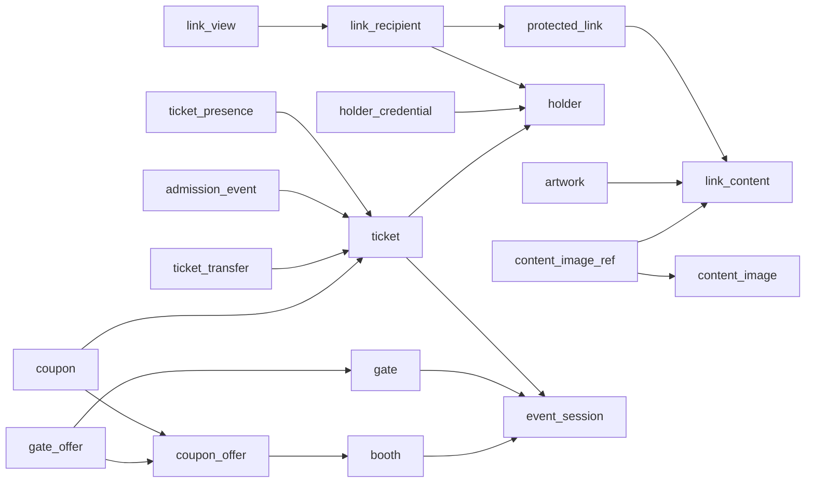

# 현재 DB 스키마

2026-10-10 Supabase PostgreSQL 조회 및 충돌 복구 결과. 접속 비밀정보와 사용자 데이터는 포함하지 않는다.

## 환경

| 실행 경로 | 설정 파일 | 스키마 | 적용 버전 |
|---|---|---|---|
| `scripts/run-dev.sh` | `.env` | `public` | V34까지 적용·검증 완료 |
| `scripts/run-stage.sh` | `.stage/.env` | `stage_artwork_20261007` | V34까지 적용·검증 완료 |

두 스키마 모두 업무 테이블 29개와 `flyway_schema_history`가 있다.

## 마이그레이션 충돌 해결

운영의 V32 `test events`를 유지하고 작품 변경을 V33·V34로 옮겼다. 운영·stage 모두 적용과 기본 Flyway 검증을 완료했다.

백업 위치, stage 이력 조정 절차, 데이터 보존 확인, 실행 스크립트 변경 및 남은 기동 문제는 [2026-10-10 변경 기록](2026-10-10-migration-and-startup.md)에 정리했다.

## 테이블 역할

| 영역 | 테이블 | 역할 |
|---|---|---|
| 관리자 | `admin_account` | 관리자 계정, 로그인 잠금, 콘솔 권한, 공개 주소 slug |
| 수신자 인증 | `holder`, `holder_credential` | 이메일 기준 사람 식별 및 사람별 패스키 |
| 이메일 인증 | `email_otp` | 목적별 OTP 해시, 만료, 시도 횟수 |
| 보호 링크 | `protected_link` | 외부 URL 또는 내부 콘텐츠, 소유자 및 보호 정책 |
| 개인 링크 | `link_recipient` | 수신자별 주소, 이메일, 등록 상태, holder 연결 |
| 열람 기록 | `link_view` | 링크·수신자별 접근 및 인증 이벤트 |
| 콘텐츠 | `link_content` | JSON 본문, 소유자, 가져오기 출처, 전달 스냅샷 |
| 작품 | `artwork` | 원본 콘텐츠별 검색 가능한 작품 정보 |
| 작품 연결 | `content_artwork` | 콘텐츠 위치와 작품 ID 연결, 전달본 간 판매 상태 공유 |
| 이미지 | `content_image`, `content_image_ref` | 저장소 파일 메타데이터 및 콘텐츠와의 연결 |
| 행사 | `event_session` | 행사 정보, 재입장·양도·인증·위치·혼잡 정책 |
| 입장권 | `ticket`, `ticket_field` | 수신자·좌석·상태·전달 정보와 행사별 사용자 정의 필드 |
| 양도 | `ticket_transfer` | 양도 대상, 토큰, 상태, 정책 스냅샷 |
| QR | `presentation_session`, `qr_nonce` | 단기 QR 제시 세션 및 재사용 방지 |
| 단말 | `gate` | 행사별 입출구/부스 단말, 등록 및 토큰 정보 |
| 입퇴장 | `ticket_presence`, `admission_event` | 현재 재실 상태와 입퇴장 이벤트 원장 |
| 혼잡 | `zone_capacity` | 행사 구역별 수용 인원 |
| 얼굴 인증 | `face_consent`, `face_template`, `face_attempt` | 동의, 암호화 특징 벡터, 인증 시도 기록 |
| 쿠폰 | `booth`, `coupon_offer`, `coupon` | 부스, 제공 항목, 티켓별 발급·사용 쿠폰 |
| 단말 쿠폰 권한 | `gate_offer` | 단말별 발급 가능 항목 및 입장 시 자동 발급 설정 |
| DB 이력 | `flyway_schema_history` | 마이그레이션 적용 이력 |

## 주요 관계

화살표는 자식에서 참조 대상으로 향한다. 전체 FK를 나열한 도표는 아니다. `owner_sub`는 소유자 식별 문자열이며 `admin_account.id`를 참조하는 FK가 아니다.

## 최근 저장소 변경

- V29: 콘텐츠 이미지와 참조 테이블.
- V30: 같은 쿠폰의 복수 수량 허용.
- V31: 단말 쿠폰 발급 권한.
- V32: 행사 `test_event` 플래그.
- V33: 작품 `sale_status` (`NULL`, `hold`, `sold`).
- V34: 작품 `archived`, `position` BIGINT, `content_artwork` 연결. 두 환경 모두 적용 완료.

테이블 존재 여부와 마지막 적용 버전은 실제 DB에서 확인했다. 역할·관계·최근 컬럼 설명은 저장소 마이그레이션을 기준으로 하며, 운영 DB 전체 컬럼과 제약 조건의 일치 여부까지 검증한 것은 아니다.

## 작품 가격 분리 (V35·V36, 배포 전)

- V35는 `artwork`에 `price_amount NUMERIC(18,2)`, `price_currency VARCHAR(3)`,
  `price_mode` (`amount`/`inquiry`/`hidden`), `price_note`, `price_krw_rate NUMERIC(18,6)`,
  `price_rate_date DATE`를 추가한다. 금액은 음수 불가, 환율은 양수이며 기준일과 함께 저장한다.
- V36 Java 마이그레이션은 기존 `$`, `US$`, `USD`와 통화 없는 숫자를 USD로 분리한다.
  명시된 EUR/KRW 등은 해당 통화로 유지한다. 쉼표 묶음과 소수점이 명확한 값만 전환하며,
  범위·세금 문구·해석이 불확실한 값은 `inquiry`의 안내 문구로 보존한다. 빈 값은 `hidden`이다.
- 기존 `price_text`와 원본 JSON의 `price`는 마이그레이션에서 보존한다. 원본 컨텐츠 JSON에
  구조화된 필드를 추가하지만 `SELECTION` 발송 사본의 본문은 변경하지 않는다.
- 새 입력은 통화 기본값 USD, 소수점 둘째 자리까지의 금액을 사용한다. API의 금액과 환율은
  문자열로 전달해 브라우저 숫자 정밀도 손실을 막고 DB에서는 정확한 소수형으로 저장한다.
- 원화 표시는 수동 입력한 '외화 1단위당 원' 환율과 기준일이 있을 때만 제공한다.
  원금액을 바꾸지 않고 원 단위 반올림한 참고 금액을 표시하며, 통화 변경 시 입력 중 환율을 지운다.
  자동 환율 조회는 없다. KRW는 별도의 환산 표시가 없다.
- 운영·stage의 실제 적용 버전은 위 환경 표의 기존 확인 기록을 따른다. V35·V36은
  테스트 DB에서 검증 후 배포 시 함께 적용할 변경이며, 운영 DB에는 아직 적용하지 않았다.

## 웹페이지 출처 링크 (배포 전)

새 URL 가져오기는 `source_ref`에 원본 HTTP(S) 주소를 저장한다. 이전의 SHA-256 식별자는
그대로 읽을 수 있지만 URL로 복원할 수 없으므로 링크로 표시하지 않는다. 관리자 작품 수정 창과
소유자의 컨텐츠 편집 화면에서 원본 주소를 입력해 보완할 수 있다. 같은 컨텐츠의 모든 작품에
공통으로 적용하며, 발송 사본 본문에는 출처 주소를 추가하지 않는다. 기존 VARCHAR(500) 컬럼을 사용한다.

## 이전 링크 수동 연결 기능 제거 (배포 전)

관리자 작품 목록의 ‘기존 링크의 원본 작품 연결’ 화면과 전용 조회·후보 검색·연결 API를
제거했다. 현재 발급하는 링크의 자동 `content_artwork` 연결과 판매 상태 공유는 유지한다.
기존 연결 데이터와 이미 발급된 링크는 삭제하지 않는다.
