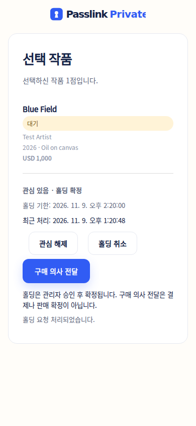
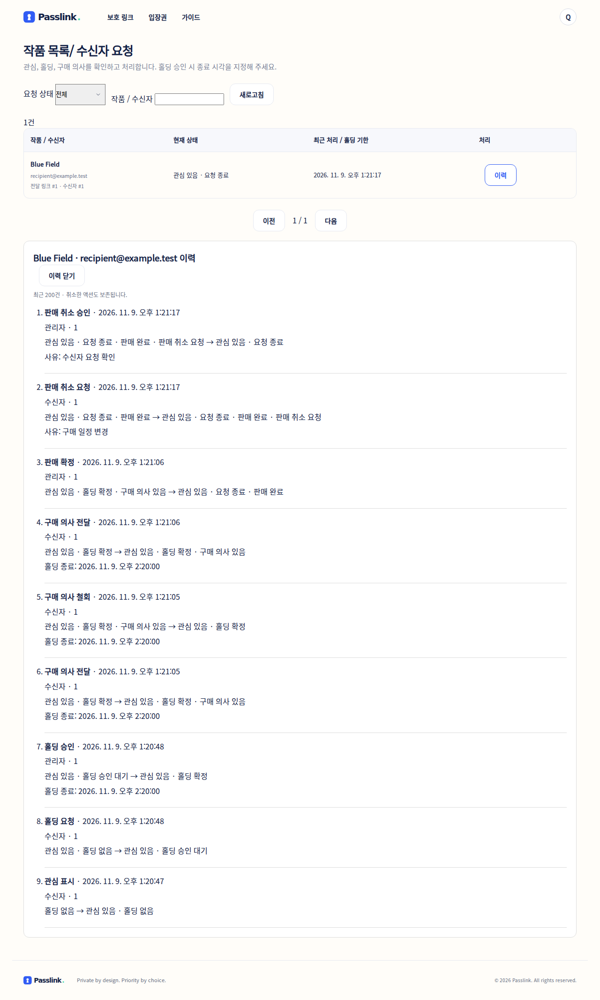

# 수신자 작품 액션 (1차)

전달 링크에서 패스키 인증한 수신자가 작품별로 관심, 홀딩 요청, 구매 의사를 전달한다. 작품 라이브러리에 연결된 작품만 대상이다. 관심·홀딩·구매 의사는 독립적으로 보존한다.

## 수신자와 관리자 흐름

- 관심 표시/해제는 즉시 적용한다.
- 홀딩 요청은 승인 대기로 접수한다. 관리자가 미래의 종료 시각을 지정해 승인하면 작품 상태가 홀딩이 된다. 거절에는 사유가 필요하다.
- 대기/확정 홀딩은 수신자가 직접 취소할 수 있다. 관심은 유지된다. 관리자는 홀딩을 해제할 수 있다.
- 홀딩 기한은 30초 주기의 작업에서 자동 해제한다. 만료 작업은 한 번에 200건 처리하며 다음 주기에 이어 처리한다. 구매 의사는 유지한다.
- 구매 의사는 즉시 전달되며 결제나 판매 확정이 아니다. 철회 시 홀딩도 함께 취소할지 선택한다.
- 판매는 관리자가 구매 의사를 표시한 수신자를 지정해 확정한다. 다른 수신자의 대기 홀딩과 구매 의사는 종료한다.
- 판매 확정 후에는 수신자가 사유를 적어 취소 요청을 한다. 관리자는 사유와 함께 승인/거절한다. 승인 시 작품은 미판매가 된다. 환불 처리는 이 기능에 포함하지 않는다.
- 다른 수신자에게 홀딩/판매된 작품은 관심만 표시할 수 있다. 홀딩 승인 시 다른 대기 홀딩은 종료하며 대기 순번을 제공하지 않는다.
- 링크 만료/회수/삭제는 기존 요청을 자동 취소하지 않는다. 관리자가 요청 목록에서 처리할 수 있으며 기한 있는 홀딩은 자동 만료한다. 링크 만료 화면에 전달 담당자에게 연락하도록 안내한다.

관리자 진입: **관리자 → 작품 목록 → 수신자 요청** (`/admin/artworks/requests`). 기존 전체 작품 관리와 동일하게 `canAccounts` 권한이 필요하다. 전체/관심/승인 대기/홀딩/구매 의사/판매 취소 필터, 작품명·수신 이메일 검색, 30건 페이지, 요청별 최근 200건 이력을 제공한다. 오래된 이력도 DB에 보존한다.

수신자 상태는 링크당 15초마다 갱신하며 작품 판매 상태는 기존 SSE를 사용한다. 취소·만료·거절 후에도 이력이 남는다. 요청이 있는 원본 컨텐츠의 삭제는 차단한다.

## 데이터와 일관성

`V58__recipient_artwork_actions.sql`:

- `artwork_request`: 수신자 × 작품의 현재 상태, 전달 링크/수신 이메일/작품명 스냅샷, 변경 버전.
- `artwork_reservation`: 작품을 PK로 사용하는 활성 홀딩. 중복 홀딩을 DB 제약으로 차단한다.
- `artwork_request_event`: 행위자, 액션, 이전/이후 상태, 사유, 시각, 중복 처리 방지 키. 상태 변경과 같은 트랜잭션으로 저장하며 기존 활동 로그에도 이벤트를 남긴다.

모든 변경은 작품 행을 먼저 잠근다. 관리자 승인, 수신자 취소, 자동 만료, 기존 판매 상태 변경이 동일한 잠금 규칙을 사용한다. 요청의 `version`으로 오래된 화면의 수정을 거절하고, 같은 `key`와 본문 재전송은 이력을 중복 생성하지 않는다. 키 재사용 시 행위자·본문이 다르면 거절한다.

기존 판매 상태 드롭다운은 수신자의 활성 홀딩/판매 확정을 덮어쓸 수 없다. 요청 목록에서 처리하도록 안내한다. 수신자 없는 수동 홀딩에는 자동 만료를 적용하지 않는다.

## API

- `GET /api/links/s/{code}/artwork-requests`: 인증된 수신자 본인의 상태.
- `POST /api/links/s/{code}/artwork-requests/{artworkId}`: 수신자 액션. `{slug}/{code}` 주소도 지원.
- `GET /api/admin/artworks/requests?filter=all&page=0&search=`: 관리자 목록.
- `POST /api/admin/artworks/requests/{id}`: 관리자 처리.
- `GET /api/admin/artworks/requests/{id}/history`: 최근 이력.

변경 본문: `action`, `version`, `key`(UUID), 선택적 `holdUntil`(ISO 시각), `reason`, `releaseHold`. 수신자 ID는 요청 본문으로 받지 않고 기존 패스키 세션에서 결정한다. CSRF 보호, 링크 만료/회수 검사, 링크에 포함된 작품인지 검사를 적용한다. 수신자 API는 타인의 의사/신원을 반환하지 않는다.

환경 변수 추가 없음. 운영 배포 시 Flyway 마이그레이션이 필요하다. 이메일 알림, 결제/환불, 자동 홀딩 승인, 대기 순번은 후속 범위다.

## 검증

`ArtworkRequestTest`는 상태 전이, 취소/철회, 만료, 중복 요청, 오래된 버전, 동시 승인, 이력 저장 실패의 롤백, 수신자 인증/작품 범위/CSRF/관리자 권한을 확인한다. 전체 Java 테스트와 두 프런트엔드의 TypeScript/production build를 실행한다.

검증 결과 (2026-11-09):

- `./mvnw -q test package`: 422건, 실패/오류 0, 기존 건너뜀 1건. 신규 기능 테스트 10건 포함.
- `cd frontend && npm run build`: 두 앱의 TypeScript 검사와 빌드 통과.
- `node scripts/check-artwork-requests-browser.mjs`: 격리된 H2 서버에서 실제 이메일 인증/가상 패스키, 관심, 홀딩 승인, 구매 의사/철회, 판매/취소, 9건의 이력, 390px 모바일 화면 확인.

브라우저 재현: 프런트엔드에서 `BACKEND_URL=http://localhost:18082 npm run dev -- --host 127.0.0.1 --port 13002`를 실행한 뒤 위 스크립트를 실행한다. 스크립트는 새 메모리 DB와 임의 테스트 비밀번호를 사용하고 서버를 종료한다. 한글 글꼴이 없는 QA 환경에서는 `QA_FONT_PATH`에 로컬 OTF 글꼴을 지정할 수 있다. 글꼴은 캡처에만 적용하며 제품의 정적 자산에 포함하지 않는다.

